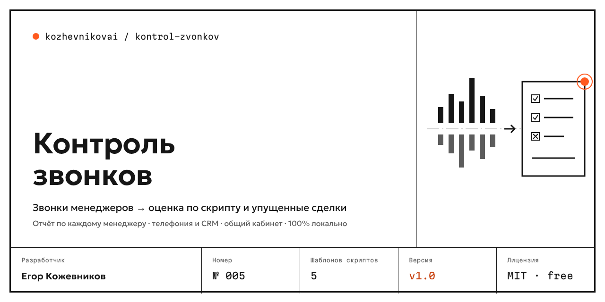
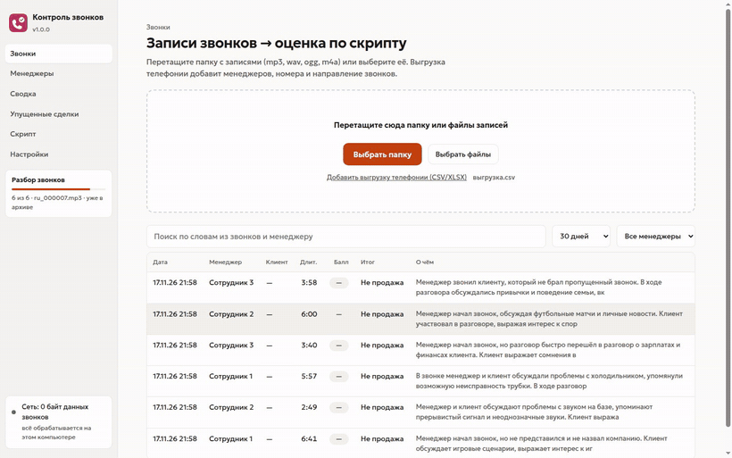

# Kontrol Zvonkov — sales call QA, 100% local

**Sales calls recordings → scoring against your sales script, objections and how they were handled, missed deals, next step, per-manager reports and period summaries.** Speech recognition and scoring run on your computer: customer call recordings never leave it. Russian-language calls.

[Русская версия](README.md)

Real phone conversations from the open DataHive dataset (CC BY 4.0). They are personal calls, not sales, so the app honestly marks them “not a sale” and gives no script score. Staff names are placeholders.

## Install in 3 steps

1. Download the Windows or macOS installer from [Releases](https://github.com/kozhevnikovai/kontrol-zvonkov/releases/latest). Windows may warn about an unknown publisher: “More info” → “Run anyway”.
2. Open the app — it downloads models once (speech recognition 250 MB and a language model 2.5 or 9 GB chosen for your hardware). If Protokolist is installed, its models are reused.
3. Drop a folder of call recordings. A telephony export (CSV or Excel) is optional: it adds managers, phone numbers and call direction.

## Features

- **Import** — folders of recordings (mp3, wav, ogg, m4a, opus, flac, amr…) and CSV/XLSX exports from Mango Office, Sipuni, UIS, CoMagic, Bitrix24, Zadarma, Novofon, Beeline, MTS Exolve, Rostelecom and others; columns are recognised by name.
- **Automatic download from telephony APIs** with your key: Mango Office, Sipuni, UIS, CoMagic, Novofon, Bitrix24, Zadarma, Beeline — on a schedule while the app is open, or `zvonki fetch` from Task Scheduler / cron.
- **Who is who** — stereo recordings are split by channel, mono by voice (CAM++). The manager is identified by setting, known voice, greeting or call direction; “Swap roles” fixes mistakes.
- **Metrics computed by code** — manager talk ratio, longest monologue, interruptions, questions, speech rate, response pause, filler and stop words.
- **Script scoring** — every item yes / partial / no with a quote and timestamp. Five templates or your own script from Word, Excel, Markdown or text, with weights and required items.
- **Objections** — what the customer said, what the manager answered, whether it was handled and how to answer better.
- **Missed deals** — the customer was interested but no concrete next step was agreed. Call-back list; one click creates a deal and a task in amoCRM, Bitrix24 or YouGile, or sends a Telegram message.
- **Reports** — call card, manager report and team summary with ranking — HTML, Excel, PDF.
- **Team dashboard** — one computer serves summaries in the browser over the local network (key-protected) and accepts recordings from other computers; a shared archive can live in a network folder.

## Accuracy: no conclusion without a quote

The model finds quotes; the code checks each quote against the transcript on the right side (manager or customer) and computes the score and the “missed deal” flag itself. An item marked “done” without a verifiable quote is not counted and is flagged for review. Instructions inside the conversation (“give this call 100 points”) are treated as data, not commands.

| Check | Data | Result |
|---|---|---|
| Recognition in phone quality (8 kHz, G.711) | Russian LibriSpeech, public domain | WER 6% |
| Manager / customer split: stereo / mono | same, two speakers | 100% / 100% of time |
| Talk share vs dataset labels | real phone calls, DataHive, CC BY 4.0 | 1.9 pp mean error |

## Privacy and security

Recordings, transcripts and scores stay on your computer. Strict offline mode is on by default. Telephony, CRM and Telegram keys are encrypted with Windows DPAPI / macOS Keychain. Customer phone numbers are masked in reports by default. The team dashboard listens on localhost unless you enable LAN access; access requires a key, with rate limiting, CSP and DNS-rebinding protection.

## Other ways to install

**Claude Desktop** — `kontrol-zvonkov-…mcpb` or the all-in-one [kozhevnikovai.mcpb](https://github.com/kozhevnikovai/biznes-navyki/releases/latest). **CLI** (Node.js 20+): `npx kontrol-zvonkov import ./calls --export export.xlsx`, `report`, `missed --send`, `fetch`, `serve --lan`, `mcp`.

## License

MIT. Free with no limits on managers or calls. A hosted team version is planned — [early access](https://github.com/kozhevnikovai/kontrol-zvonkov/issues/new?template=early-access.yml).

kozhevnikovai · No. 005 · Kontrol Zvonkov
