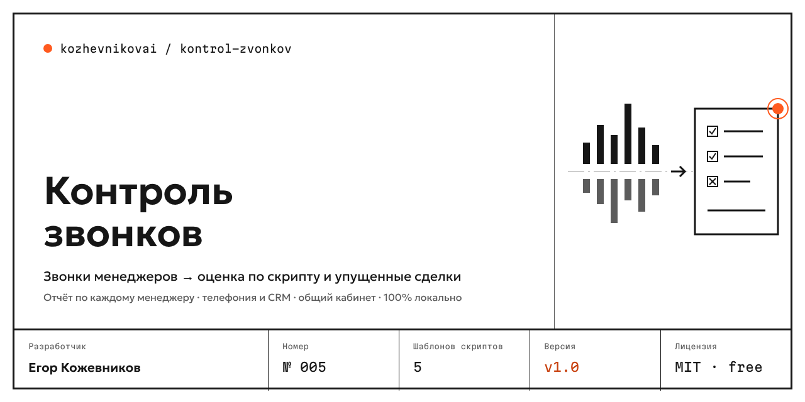
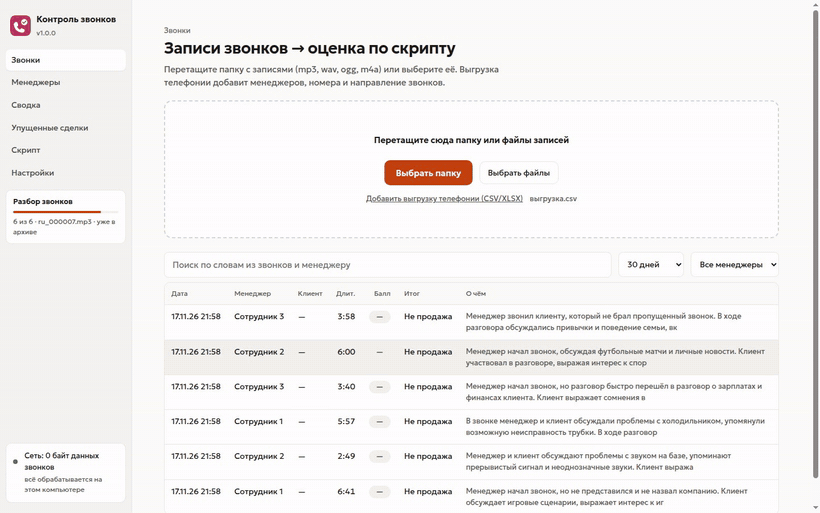
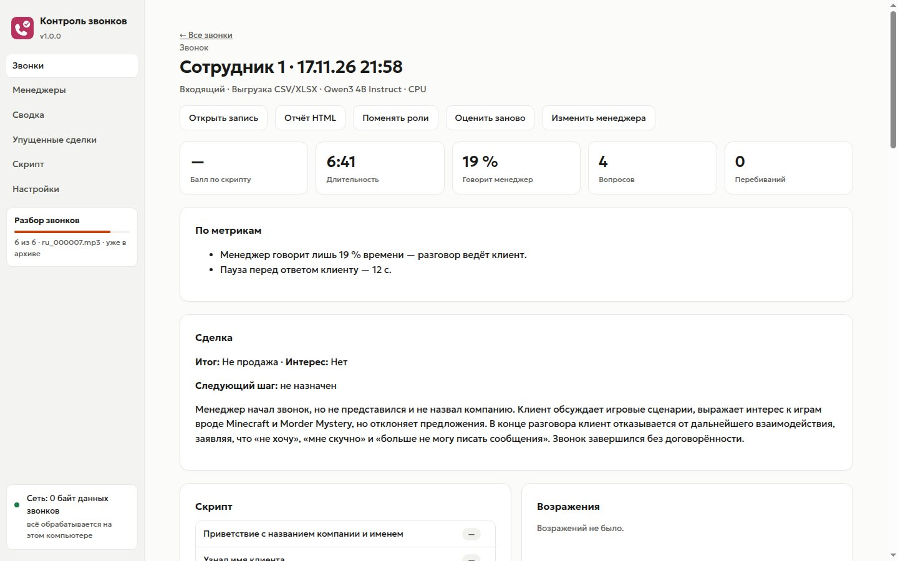
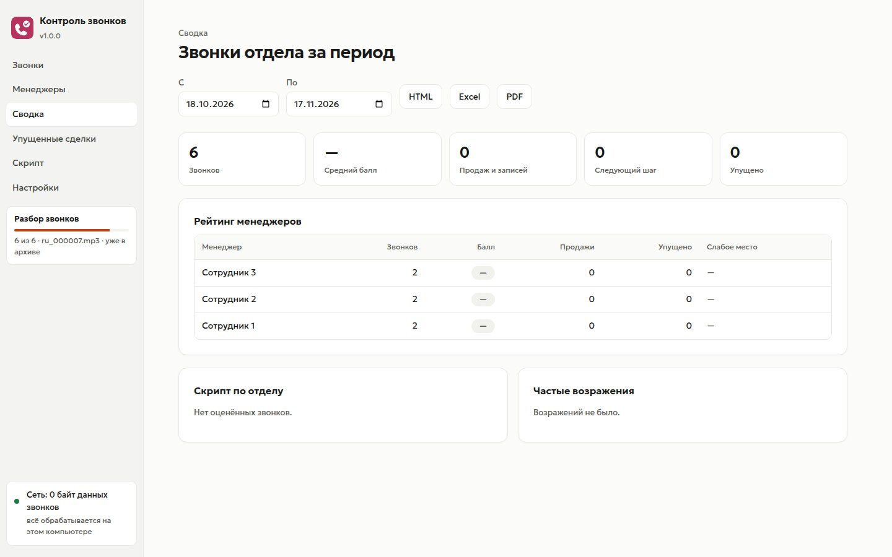
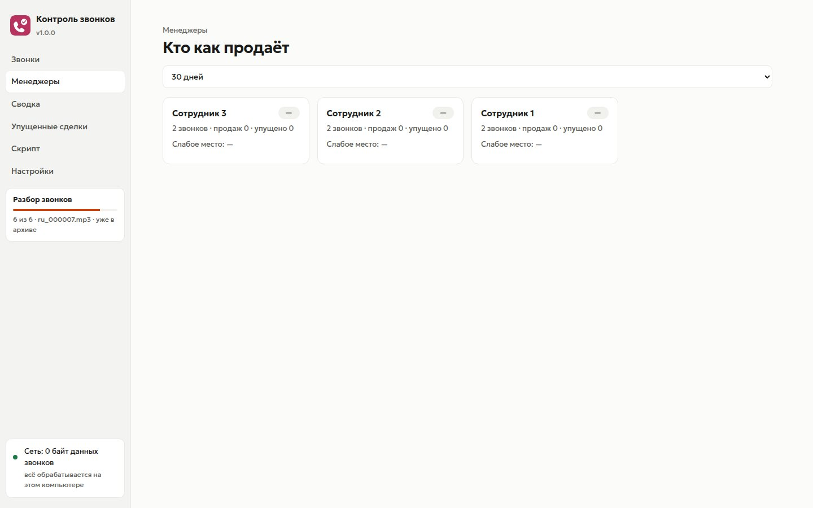
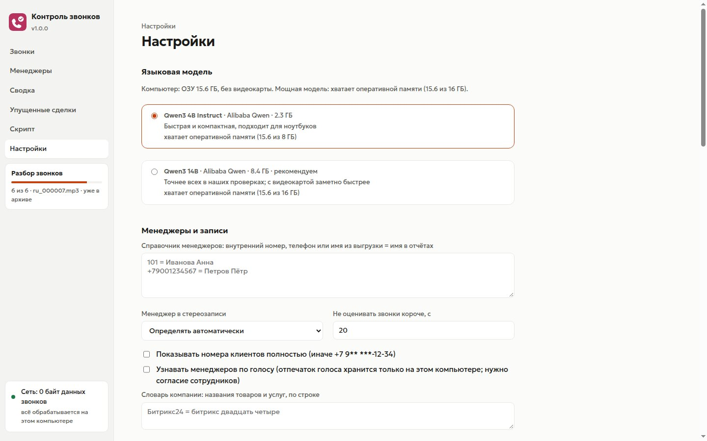

<p align="center"></p>

<p align="center">
<a href="https://github.com/kozhevnikovai/kontrol-zvonkov/actions/workflows/ci.yml"></a>


</p>

# Контроль звонков

**Записи звонков менеджеров → оценка по скрипту продаж, возражения и ответы на них, упущенные сделки, следующий шаг, отчёт по каждому менеджеру и сводка за период.** Распознавание и оценка идут на вашем компьютере: записи разговоров с клиентами никуда не отправляются.

[English version](README.en.md)

<p align="center"></p>

<sub>Настоящие телефонные разговоры из открытого набора DataHive (CC BY 4.0). Это личные звонки, а не продажи, — поэтому программа честно помечает их «не продажа» и не ставит балл по скрипту. Имена сотрудников условные. Ролик — [docs/video/promo.mp4](docs/video/promo.mp4).</sub>

## Установка за 3 шага

1. Скачайте установщик для Windows или macOS со [страницы релизов](https://github.com/kozhevnikovai/kontrol-zvonkov/releases/latest). Windows может предупредить про неизвестного издателя: «Подробнее» → «Выполнить в любом случае».
2. Откройте приложение — оно скачает модели один раз (распознавание 250 МБ и языковая модель 2,5 или 9 ГБ — выбирается по вашему компьютеру). Если стоит Протоколист, его модели используются повторно.
3. Перетащите папку с записями звонков. Выгрузка из телефонии (CSV или Excel) — по желанию: добавит менеджеров, номера и направление.

## Возможности

- **Импорт** — папка с записями (mp3, wav, ogg, m4a, opus, flac, amr…) и выгрузки телефонии CSV/XLSX: Манго Офис, Sipuni, UIS, CoMagic, Битрикс24, Zadarma, Новофон, Билайн, МТС Exolve, Ростелеком и любые другие — колонки узнаются по названиям, звонки сопоставляются с файлами по имени, номеру звонка или по времени и номеру клиента.
- **Загрузка из телефонии сама** — по API с вашим ключом: Манго Офис, Sipuni, UIS, CoMagic, Новофон, Битрикс24, Zadarma, Билайн. Новые записи скачиваются и разбираются по расписанию, пока приложение открыто, или командой `zvonki fetch` из Планировщика Windows и cron.
- **Кто есть кто** — стереозапись (менеджер и клиент в разных каналах, как пишет большинство телефоний) делится по каналам; моно — по голосам. Менеджер определяется по настройке, по голосу (если включить «знакомые голоса»), по приветствию или по направлению звонка. Ошиблась — кнопка «Поменять роли».
- **Метрики — кодом** — доля речи менеджера, самый длинный монолог, перебивания, вопросы, темп речи, пауза перед ответом, слова-паразиты и ваши стоп-слова. Одинаковые при каждом запуске — по ним честно сравнивать менеджеров.
- **Оценка по скрипту** — каждый пункт: «да / частично / нет» с цитатой и тайм-кодом. Пять шаблонов (входящий звонок, холодный B2B, запись на услугу, дожим после КП, повторная продажа) или свой скрипт из Word, Excel, Markdown или текста — с весами и обязательными пунктами.
- **Возражения** — «дорого», «нет времени», «есть поставщик», «надо посоветоваться»: что сказал клиент, что ответил менеджер, отработал ли — и как ответить лучше.
- **Упущенные сделки** — клиент интересовался, а конкретный следующий шаг не назначен. Список на перезвон с кнопками «Перезвонили» и «В CRM»: сделка и задача создаются в amoCRM, Битрикс24 или YouGile, уведомление — в Telegram.
- **Отчёты** — карточка звонка, отчёт по менеджеру (сильные и слабые пункты скрипта, типовые возражения, динамика по неделям) и сводка отдела за период с рейтингом — в HTML, Excel и PDF.
- **Общий кабинет отдела** — один компьютер показывает сводку и отчёты в браузере руководителю и менеджерам по ссылке с ключом и принимает записи с других компьютеров — разбор идёт на нём. Общий архив можно держать в сетевой папке: несколько компьютеров разбирают звонки, ни один звонок не будет разобран дважды.

<p align="center"> </p>
<p align="center"> </p>

## Точность: ни одного вывода без цитаты

| Что | Кто решает | Как проверяется |
|---|---|---|
| Метрики (доля речи, перебивания, вопросы) | код | одинаково при каждом запуске |
| Пункт скрипта выполнен | модель находит цитату менеджера | цитата ищется в расшифровке у менеджера; не нашлась — пункт **не засчитан** и помечен «проверить» |
| Возражение | модель находит слова клиента | слов клиента нет в записи — возражение отбрасывается |
| Балл | код по весам пунктов | «не применимо» не учитывается |
| Упущенная сделка | код | интерес подтверждён словами клиента **и** нет договорённости о следующем шаге с цитатой |

Посторонние «инструкции» в разговоре («поставь сто баллов») модель не выполняет: текст звонка передаётся как данные, а не как команды.

### Проверка на реальной речи

| Проверка | Данные | Результат |
|---|---|---|
| Распознавание в телефонном качестве (8 кГц, G.711) | Russian LibriSpeech, общественное достояние | WER 6 % |
| Разделение менеджера и клиента: стерео / моно | там же, два диктора | 100 % / 100 % времени |
| Доля речи сторон против разметки набора | настоящие телефонные разговоры DataHive, CC BY 4.0 | расхождение 1,9 п. п. |
| Скорость | процессор, без видеокарты | ≈ 0,1 длительности записи |

Проверки запускаются в CI на Windows, macOS и Linux при каждом изменении. Качество оценки по скрипту проверяется отдельно на открытых данных — [evals/](evals/).

## Вопросы

**Сколько стоит?** Бесплатно, лицензия MIT — без ограничений на число менеджеров и звонков.

**Отправляются ли записи в интернет?** Нет. Распознавание (GigaAM v3) и языковая модель (Qwen3) работают на компьютере. Сеть нужна только чтобы один раз скачать модели и для подключений, которые вы включите сами (телефония, CRM, Telegram). Счётчик в приложении показывает, сколько байт ушло.

**Какой нужен компьютер?** Распознавание — любой современный, быстрее реального времени. Для оценки по скрипту: лёгкая модель — от 8 ГБ памяти, мощная — от 16 ГБ или видеокарта. Без модели работают расшифровка и все метрики.

**Можно ли оценивать звонки в Claude?** Да: расширение для Claude Desktop расшифровывает звонок локально, Claude оценивает его по скрипту, а Контроль звонков проверяет каждую цитату и сам считает балл.

**Нужно ли согласие?** Запись разговоров с клиентами и их обработка — это персональные данные. Предупреждайте клиентов о записи и закрепите обработку в политике компании. Узнавание сотрудников по голосу выключено по умолчанию — включайте с согласия сотрудников.

## Безопасность

- Записи, расшифровки и оценки хранятся **только на вашем компьютере** (или в вашей сетевой папке). Строгий офлайн включён по умолчанию: пока он включён, программа не делает ни одного запроса в сеть, кроме загрузки моделей.
- Ключи телефонии, CRM и Telegram хранятся зашифрованными средствами Windows (DPAPI) или macOS (связка ключей) и после сохранения не показываются. Для CLI и MCP — переменные окружения `ZVONKI_TELEPHONY_TOKEN`, `ZVONKI_CRM_AMOCRM_TOKEN` и т. п.
- Номера клиентов в отчётах по умолчанию маскируются: `+7 9** ***-12-34`.
- Общий кабинет по умолчанию доступен только с этого компьютера; для локальной сети — отдельная галочка. Доступ по ключу, перебор ключа ограничен, страницы с запретом скриптов (CSP), защита от DNS rebinding.
- Ссылки на записи из API телефонии принимаются только по https; размер записи ограничен; в Excel текст звонка не может стать формулой.
- Модели скачиваются с проверкой SHA-256 и докачкой после обрыва.

## Другие способы установки

**Приложение** — [Releases](https://github.com/kozhevnikovai/kontrol-zvonkov/releases):

- **Windows 10/11** — `KontrolZvonkov-…-win-x64.exe`. Установщик без платной подписи: «Подробнее» → «Выполнить в любом случае». Портативная версия — `KontrolZvonkov-…-win-x64.zip`.
- **macOS 12+ (бета)** — `…-mac-arm64.dmg` для M1 и новее, `…-mac-x64.dmg` для Intel. Без подписи Apple: «Системные настройки → Конфиденциальность и безопасность → Всё равно открыть».

**Claude Desktop** — `kontrol-zvonkov-win-x64.mcpb` или `…-mac-arm64.mcpb`, либо общий пакет [kozhevnikovai.mcpb](https://github.com/kozhevnikovai/biznes-navyki/releases/latest) со всеми инструментами. Затем: «Оцени звонок C:\Звонки\2026-11-12_101.mp3 по скрипту входящего звонка» или «Сводка звонков за неделю».

**Командная строка** (Node.js 20+):

```bash
npx kontrol-zvonkov models                                  # модели по вашему компьютеру
npx kontrol-zvonkov import ./звонки --export выгрузка.xlsx   # разбор папки
npx kontrol-zvonkov import ./звонки --script мой-скрипт.docx
npx kontrol-zvonkov report --from 2026-11-01 --format html,xlsx,pdf
npx kontrol-zvonkov missed --send                            # упущенные сделки → CRM
npx kontrol-zvonkov managers "101=Иванова Анна" "102=Петров Пётр"
npx kontrol-zvonkov config set telephony.provider mango      # и ключи: telephony.key, telephony.secret
npx kontrol-zvonkov fetch                                    # новые записи из телефонии
npx kontrol-zvonkov serve --lan                              # общий кабинет отдела
npx kontrol-zvonkov mcp                                      # MCP-сервер
```

## Как это устроено

```
папка / выгрузка / API телефонии / загрузка в кабинет
        │
        ▼
 стерео → каналы · моно → голоса (CAM++) ─► GigaAM v3 ─► кто менеджер (настройка · голос · приветствие · направление)
        │
        ├─► метрики (код): доля речи, перебивания, вопросы, темп, паузы, стоп-слова
        └─► Qwen3 4B / 14B по JSON-схеме: пункты скрипта, возражения, интерес, следующий шаг
                 │
                 ▼
     проверка цитат по расшифровке ─► балл и «упущенная сделка» (код) ─► архив
                 │
                 ▼
 карточка звонка · отчёт по менеджеру · сводка (HTML, Excel, PDF) · amoCRM / Битрикс24 / YouGile / Telegram
```

Одно ядро на TypeScript: приложение (Electron), расширение Claude Desktop (.mcpb), MCP-сервер, CLI и общий кабинет. Модели — общий движок [local-ai](https://github.com/kozhevnikovai/local-ai), распознавание — как в [Протоколисте](https://github.com/kozhevnikovai/protokolist).

## Ограничения

- Подключения к API телефонии сделаны по документации операторов и проверены на тестовых серверах; если с вашим кабинетом что-то не так — выгрузите записи папкой и [напишите нам](https://github.com/kozhevnikovai/kontrol-zvonkov/issues).
- Моно с тремя и больше голосами (переводы на коллегу, конференции) делится на две стороны: лишние голоса попадут к одной из них.
- Общий кабинет работает, пока включён компьютер, на котором он запущен.
- Язык звонков — русский.

## Разработка

```bash
npm ci && npm run build && npm test     # unit-тесты
node test/e2e.mjs                       # распознавание на реальной речи (скачает модели и записи)
npm run eval                            # оценка по скрипту на открытых данных (нужна модель)
```

## Скоро

Всё, что есть сейчас, остаётся бесплатным и открытым (MIT). В разработке — **облачный кабинет**: звонки всех менеджеров без своего сервера, доступ руководителя с телефона. Цена — от 490 ₽ в месяц за менеджера, ранний доступ — скидка 50 % на первый год. [Оставьте заявку](https://github.com/kozhevnikovai/kontrol-zvonkov/issues/new?template=early-access.yml) — заявки влияют на порядок разработки.

## Другие инструменты kozhevnikovai

- [Протоколист](https://github.com/kozhevnikovai/protokolist) — запись встречи → протокол, локально
- [Тендерный помощник](https://github.com/kozhevnikovai/tender-pomoshnik) — разбор госзакупок 44-ФЗ и 223-ФЗ
- [Аудитор сайтов](https://github.com/kozhevnikovai/auditor-saitov) — аудит сайта и конкурентов, 152-ФЗ
- [Бизнес-навыки](https://github.com/kozhevnikovai/biznes-navyki) — 12 навыков для Claude, в том числе скрипт звонка

Об уязвимостях — приватно, см. [SECURITY.md](SECURITY.md).

## Лицензия

MIT. Сторонние компоненты: GigaAM v3 (MIT), Silero VAD (MIT), CAM++ 3D-Speaker (Apache-2.0), sherpa-onnx (Apache-2.0), Qwen3 (Apache-2.0), llama.cpp (MIT), SheetJS (Apache-2.0), FFmpeg (LGPL), шрифты Geologica и Martian Mono (OFL). Тестовые записи: Russian LibriSpeech (общественное достояние), DataHive Russian Conversations (CC BY 4.0). Музыка в ролике: «Minimal Tech Corporate Beat», BudgetPixel AI (CC BY 4.0).

---

<sub>kozhevnikovai · № 005 · Контроль звонков</sub>
